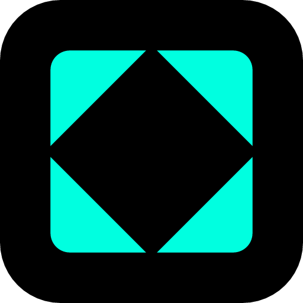

<div align="center">
  
  <h1>Contrast3D & NainDev</h1>
  <p><strong>Deterministic product conformance, interactive 3D inspection, and enterprise systems</strong></p>

  <p>
    
    
    
    
    
    
    
  </p>
</div>

---

### Ecosystem Architecture

Our technology portfolio is built as decoupled, single-responsibility systems with zero runtime coupling:

```
+-------------------------------------------------------------------------------+
|                                  ContrastHub                                  |
|            Collaborative CRM, asset management, and lifecycle hub             |
+---------------------------------------+---------------------------------------+
                                        |
                   +--------------------+--------------------+
                   |                                         |
                   v                                         v
+---------------------------------------+ +-------------------------------------+
|            ContrastViewer             | |                 DSE                 |
|       Interactive 3D Component       | |    Deterministic Conformance Chassis|
|  Three.js Web Component (Browser)     | |    FastAPI, PostgreSQL, Stdio/MCP   |
+---------------------------------------+ +-------------------------------------+
                   |                                         ^
                   |         Verified Asset Seal (SHA-256)   |
                   +-----------------------------------------+
```

---

### Products

#### ContrastViewer
High-performance, embeddable 3D web component (`<contrast-vehicle-viewer>`) built with Three.js and strict TypeScript.
- **In-browser validation:** Verifies asset integrity using canonical SHA-256 seals emitted by DSE.
- **Industrial visual fidelity:** Physically based rendering, custom camera framing, exploded views, and hotspot annotations.
- **Framework agnostic:** Standards-compliant Custom Element with native DOM event dispatching.

#### DSE (Datum Statutum Exploratum)
Deterministic conformance chassis designed to measure facts, verify mathematical invariants, and issue auditable verdicts with zero subjective heuristics.
- **3D Conformance (`rt-01` profile):** Geometry validation, texel density distribution, manifold integrity, UV layout optimization, and material parameters.
- **Dual Contract:** Strict separation between reproducible mathematical facts (`DeterministicResult`) and non-deterministic environment metadata (`AuditEnvelope`).
- **Interfaces:** High-throughput HTTP API and Model Context Protocol (MCP) server for autonomous agents.

#### ContrastHub
Collaborative commercial CRM engineered for client operations, deliverables, quotes, and workflow tracking.
- **Backend:** FastAPI with PostgreSQL and transactional audit trails.
- **Frontend:** Vue 3 SPA with strict typing.
- **Integrations:** Native consumer of DSE verification services and ContrastViewer components.

---

### Engineering Principles

- **Deterministic Verification:** Every conformance check relies on strict quantization and published mathematical tolerances. No arbitrary heuristics.
- **Decoupled Contracts:** Products integrate exclusively through versioned APIs, schemas, and cryptographic checksums.
- **Self-Hosted Infrastructure:** Production workloads operate on dedicated hardware nodes with automated CI/CD gating and zero cloud runtime lock-in.

---

### Portals & Resources

- **ContrastHub Platform:** [contrast3dhub.com](https://contrast3dhub.com)
- **DSE Engine:** [datumstatutum.com](https://datumstatutum.com)
- **Technical Contact:** amendoza@contrast3d.com
